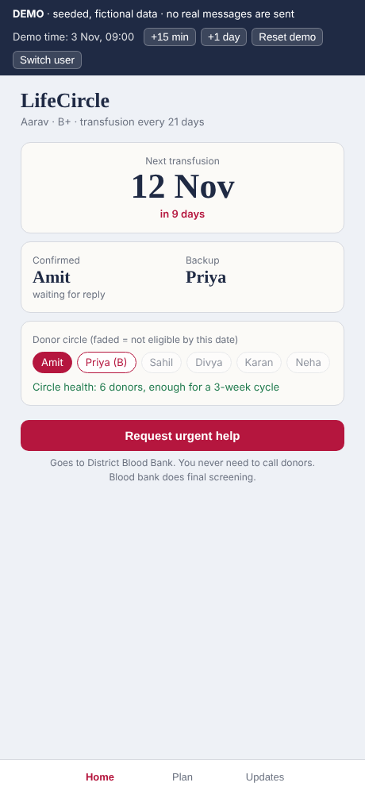
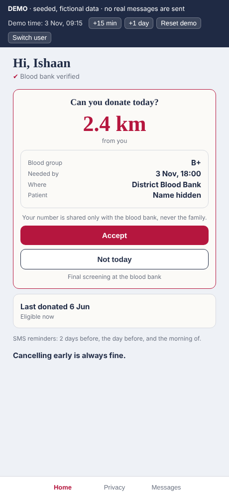
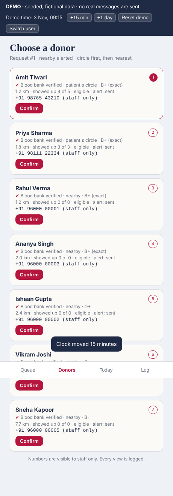

# LifeCircle

**LifeCircle plans blood donations in advance for regular-transfusion patients, and when a plan falls through, it finds the next eligible donor nearby in minutes.**

Capstone prototype (Milestone 2): Python / FastAPI backend, SQLite, and a plain HTML/JS demo app for the three roles: patient family, donor and blood bank staff. All data is seeded and fictional.

| Family home | Donor urgent alert | Staff: choose a donor |
|---|---|---|
|  |  |  |

## Run it
```bash
python -m venv .venv && source .venv/bin/activate     # Windows: .venv\Scripts\activate
pip install -r requirements.txt
uvicorn app.main:app --reload
```
Open http://127.0.0.1:8000 for the demo app and http://127.0.0.1:8000/docs for the API.
The database is created and seeded on first start. **Reset demo** in the top bar re-seeds it.
To freeze the date so it matches the wireframes: `LIFECIRCLE_TODAY=2026-11-03 uvicorn app.main:app`.

Run the tests: `pytest -q`

## Milestone 2 deliverables
- [Data models](docs/DATA_MODELS.md)
- [Network / endpoint requests](docs/API_ENDPOINTS.md)
- [Demo script](docs/DEMO_SCRIPT.md)
- [What this doesn't do](docs/SCOPE.md)

## How the core logic works
| Piece | File | In one line |
|---|---|---|
| Eligibility pre-check | `app/services/eligibility.py` | Indian NBTC rules (age 18–65, ≥45 kg, 90/120-day gap) + not deferred + verified + ABO/Rh compatible |
| Fair rotation | `app/services/rotation.py` | fewest donations to this patient in 12 months, then longest since last turn, then best reliability |
| Planned mode | `app/services/scheduling.py` | next date = last + cycle; confirmed + backup; cancel promotes backup; uncovered date goes to the blood bank |
| Urgent mode | `app/services/urgent.py` | blood bank approves, circle alerted, after 15 min nearby donors within 10 km ranked by distance, first accept wins |
| Distance | `app/services/geo.py` | haversine straight-line km from the blood bank |
| Privacy routing | `app/privacy.py` | one function decides what each role sees about a donor; staff phone views are logged |
| Roles | `app/auth.py` | bearer token after phone + OTP; every router is locked to one role |

## Project layout
```
app/
  main.py          FastAPI app, auth + demo endpoints, serves the frontend
  models.py        data models (11 tables)
  privacy.py       role-based donor views
  auth.py          sign-in + role guard
  seed.py          fictional demo data
  routers/         family.py, donor.py, staff.py
  services/        eligibility, rotation, scheduling, urgent, geo, outcomes, notify
frontend/          index.html, app.js, styles.css (no build step)
tests/             end-to-end tests of the core loop
docs/              Milestone 2 documents and screenshots
```
